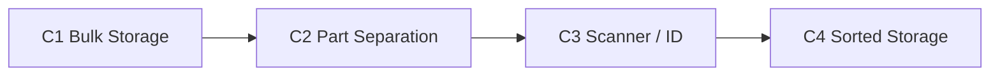

# LEGO Sorter — Master Plan

**Hub** for component names, status, build order, and integration. README is the landing page; deep dives live in [`plans/`](plans/). Architecture follows the [BrickSortingMachine 4-module model](https://bricksortingmachine.com/lego-sorting-machine-diy-build-instructions).

## Components



**Concept visualization:** [docs/concept-model/](docs/concept-model/) is a schematic Three.js model of this pipeline (hybrid fidelity — planning dims for belt/chamber; robot layout conceptual). Use it for docs screenshots, not for machining or print tolerances.

| # | Component | Role | Status | Plan |
|---|-----------|------|--------|------|
| 1 | Bulk storage | Meter a trickle from the pile | Planned | [01](plans/01-bulk-storage.md) |
| 2 | Part separation | Singulate; drop into catch tray | **Belt running** | [02](plans/02-part-separation.md) |
| 3 | Scanner / ID | Identify part/color; Gradio UI | **Feed loop working** | [03](plans/03-scanner-identification.md) · [05 chamber](plans/05-scan-chamber.md) |
| 4 | Sorted storage | ReBeL catch-tray dump into bins | **CRI verified** | [04](plans/04-sorted-storage.md) |

## Current hardware (2026-07)

| Piece | Status | Notes |
|-------|--------|-------|
| igus ReBeL | On hand, CRI verified | USB ethernet; `run_robot_*.py` |
| 3D-printed conveyor | Running | UNO R4 WiFi + TB6600; [hardware/feeder/](hardware/feeder/) |
| Vision | Open-air stand-in | **Next:** fixed stage + light box + trapdoor ([05](plans/05-scan-chamber.md)) |

## Scope phases

1. **Now:** Fixed scan-stage light box ([05](plans/05-scan-chamber.md) Phases 1–2); scoop under trapdoor; dump poses
2. **Next:** Trapdoor + pipeline interlock (Phase 3); HSV color; set-aware routing
3. **Then:** Hopper (C1); reliability (G3); friend demo (G4)

## Integration flow

Inclined chain belt discharges onto a **fixed lit scan stage**. Cameras identify the part there while the ReBeL can return home. When ID is done and the scoop is under the stage, a **trapdoor** drops the part into the scoop; the arm dumps into a bin — no gripper, no hand-eye calibration.

```
  Hand-fed / hopper
         │
         ▼
  ┌──────────────┐
  │ Chain belt   │  singulate (C2)
  └──────┬───────┘
         │ discharge
  ┌──────▼───────────────────────────┐
  │ LIGHT BOX — fixed stage + cams   │  C3a — [05](plans/05-scan-chamber.md)
  │         [trapdoor]               │  ID here (pipelined with arm return)
  └──────┬───────────────────────────┘
         │ after id_done ∧ arm_home
  ┌──────▼───────────┐
  │ scoop @ home     │  C4 catcher → dump → bins
  └──────────────────┘
```

**One cycle (target):**

1. `START` belt until stage occupancy → `STOP` → settle → Brickognize (and HSV later)
2. In parallel: arm may still be returning from the previous dump
3. `trapdoor_open` when `id_done ∧ arm_home` → part in scoop → dump → return
4. Close trapdoor; advance next part onto the stage

Until the chamber exists, the Gradio feed loop still uses open-air landing / tray occupancy as a stand-in.

## Build order

1. ~~Gradio + Brickognize~~ · ~~ReBeL CRI~~ · ~~Conveyor firmware + feed loop~~
2. **Scan chamber** — lit fixed stage, then trapdoor + pipeline ([05](plans/05-scan-chamber.md))
3. **Scoop + dump poses** — home under trapdoor; integrate with feed loop
4. **HSV color** + set-aware routing
5. **C1 hopper** after singulation is proven
6. Gates G3 / G4

## Phase gates

- **G1 (Vision):** ID/color accuracy ≥ 90% on a held-out check; `unknown` precision ≥ 90%
- **G2 (Runtime):** median ID ≤ 200 ms path budget for local backends; Brickognize ~0.7 s online is expected
- **G3 (Feeder):** single-part ≥ 85% / 100 parts; jams ≤ 10/100
- **G4 (Demo):** 2-min run; live accuracy ≥ 80%; ~5 parts/min sustained

MVP color scope: `red`, `blue`, `yellow`, `green` + `unknown`.

> **Throughput:** serial cycle (stop → classify → dump → return). Demonstrator ~5–8 parts/min, not a high-speed sorter.

## Fallback demo mode

If the belt is unreliable: pause → place one part in the tray by hand → classify → resume.

## Target layout

```
lego-sorter/
├── data/{sessions/, reference/}
├── docs/concept-model/           # Three.js schematic viewer
├── hardware/feeder/              # C2 as-built
├── hardware/tray/                # C4 catch tray (TBD)
├── src/
│   ├── demo_brickognize/         # C3 UI (→ scanner/ later)
│   ├── orchestrator/             # sort_cycle, routing
│   ├── feeder/                   # http_client.py + firmware/
│   └── robot/                    # CRI session + poses + dump
├── config/                       # sets.yaml (TBD)
├── data/robot/poses.json         # taught home / rest / bin dumps
└── plans/
```

## Risks

| Risk | Mitigation | Owner |
|------|------------|-------|
| Double-feed | Slow belt; `unknown` for multi-part frames | C2 |
| Lighting / AE drift | Scan chamber; lock exposure | C3 |
| Part bounces (stage or scoop) | Low drops; lips; foam; center tipping stage over scoop | C2/C3/C4 |
| Tipping-stage jam | Timeout → return flat; manual clear; fallback A | C3a |
| Stage vs arm collision | Never tip unless arm is home | C3/C4 |

## Future

- Set harvesting — [C3 routing](plans/03-scanner-identification.md#bin-routing-policy)
- Multi-angle chamber (mirror / cameras) — [05](plans/05-scan-chamber.md)
- ReBeL WiFi static IP (one-time iRC on Windows)
