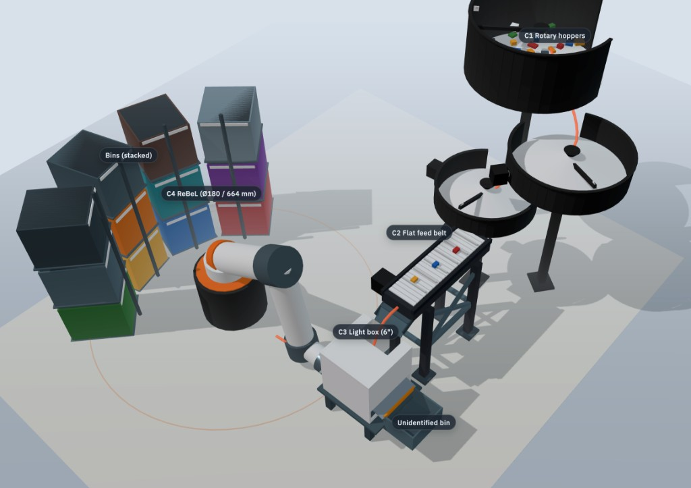

# Concept model (Three.js)

Browser-based **schematic** visualization of the full LEGO sorter:
cascading **bulk-scale** rotary hoppers → elevated flat feed belt → gravity drop
into a **6″** light box (scale anchor) with a **dual-direction tilt plate** →
ReBeL scoop in front → bins in **vertical stacks** (3 levels × 4 columns) around
the arm. Unidentified parts tip the other way into a reject bin behind the box.

This is for documentation and design discussion — **not** fabrication CAD.



## Quick start

From the repo root (ES modules need HTTP, not `file://`):

```bash
python3 -m http.server 8765
```

Open [http://localhost:8765/docs/concept-model/](http://localhost:8765/docs/concept-model/).

Requires network once to load Three.js from jsDelivr (pinned `0.170.0` via the import map in `index.html`).

## Controls

| Control | Action |
|---------|--------|
| Drag | Orbit |
| Scroll | Zoom |
| Isometric / Front / Top | Camera presets |
| Module labels | Floating C1–C4 labels |
| Process flow | Animated path beads hopper → bins |
| Tilt plate | Level / tip → scoop / tip → unidentified bin |
| Module checkboxes | Hide/show subsystems |
| Download PNG | Export current view at **1920×1080** (no labels) |

## Dimensions (hybrid)

Units in code are **millimeters**. Values live in `CONFIG` inside [`model.js`](model.js).

| Piece | Source | Notes |
|-------|--------|--------|
| Belt ~80 × 280 mm, **flat**, deck 280 mm up | [plans/02](../../plans/02-part-separation.md) | Above light box; drop chute feeds in |
| Hopper cascade (~Ø260–360 mm) | Conceptual (basically V2 scale) | Sized large vs 6″ box |
| Light box **152 mm (6″)** + dual-direction tilt plate | [plans/05](../../plans/05-scan-chamber.md) | Forward → scoop, back → unidentified |
| igus **ReBeL 6DOF** — Ø180 mm base, **664 mm** max reach (nominal 400 mm) | [igus ReBeL tech data](https://www.igus.eu/product/REBEL-6DOF-03) | Real footprint/reach; link lengths schematic |
| Bins — **3 vertical levels × 4 columns** | Conceptual | Stack up within arm reach |

## Files

```
docs/concept-model/
├── index.html    # shell + CDN import map
├── styles.css
├── viewer.js     # lights, orbit, presets, export
├── model.js      # modular THREE.Group geometry
├── preview.jpg   # concept draft screenshot (shown above)
├── scad/         # OpenSCAD parametric twin (same layout)
└── README.md
```

## OpenSCAD twin

Same schematic machine as parametric CAD under [`scad/`](scad/). Open
[`scad/sorter.scad`](scad/sorter.scad) in OpenSCAD (F5 preview) or see
[`scad/README.md`](scad/README.md) for CLI PNG/STL export.

## Replacing a module with a real GLB

Each subsystem is a named `THREE.Group` on the machine root (`hopper`, `conveyor`, `scanChamber`, `rebel`, `bins`, …). To swap one for an as-built asset:

1. Export / place a GLB under e.g. `docs/concept-model/assets/conveyor.glb`.
2. In `viewer.js` (or a small loader helper), use `GLTFLoader` from `three/addons/loaders/GLTFLoader.js`.
3. Remove or hide the procedural group (`machine.modules.conveyor`) and add the loaded scene at the same transform.
4. Keep `CONFIG` / label anchors updated if the new mesh origin differs.

Procedural groups are intentionally coarse so a GLB drop-in does not require rewriting the viewer controls.

## Related docs

- [PLAN.md](../../PLAN.md) — architecture hub
- [hardware/feeder/](../../hardware/feeder/) — as-built conveyor photos / BOM
