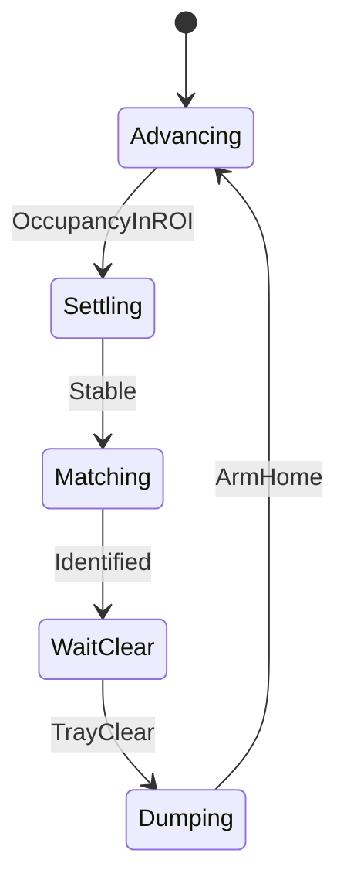

# C3 — Scanner / ID

> Part of the [master plan](../PLAN.md). Receives a settled part from [C2](02-part-separation.md); outputs a bin assignment for [C4](04-sorted-storage.md).

## Backends

| Backend | Status | Output |
|---------|--------|--------|
| **Brickognize API** | **Done** | Part name, number, category |
| **HSV color** | Planned | Color class (offline, zero training) |
| Trained color model | Optional | Only if HSV falls short |

**Routing** (part ID + color → bin) is separate from identification. Headline mode: **set-aware sorting** — parts belonging to a target LEGO set go to a set bin; everything else color-sorts. See [Bin routing](#bin-routing-policy).

## Gradio app (working)

| | |
|---|---|
| **Entry** | `run_brickognize_demo.py` |
| **UI** | `src/demo_brickognize/` |
| **Loop** | `src/orchestrator/sort_cycle.py` + `routing.py` |
| **Conveyor** | `src/feeder/http_client.py` (WiFi HTTP) |
| **Data** | `data/sessions/`, `data/reference/empty_tray.jpg`, `landing_zone.json` |

```bash
pip install -r requirements.txt
python run_brickognize_demo.py
```

**Setup tab:** camera select, conveyor URL (✓/✗ ping), empty-tray reference, landing-zone sliders (persisted).  
**Feed loop:** belt advances → occupancy in ROI → settle → still → Brickognize → wait until tray clear → advance. Failed matches retry once after ~2 s.

Brickognize: `POST https://api.brickognize.com/predict/` (multipart `query_image`). Needs internet (~0.7 s/lookup). Identifies **part type**, not color — HSV fills that gap.

Session catalog logs every scan; BrickLink valuation optional (`.env.example`).

## Scan station

**Target (B):** belt drops onto a **fixed lit stage** in a light box → identify → **trapdoor** into the ReBeL scoop at home → arm dumps. Scoop is a dumb catcher, not the photo background. Full design: **[05-scan-chamber.md](05-scan-chamber.md)**.

- Cameras/LEDs fixed to the **box** (overhead + 45°)
- Matte stage floor + locked exposure/WB
- `data/reference/empty_tray.jpg` → stage empty reference (rename later)
- Interlock: open trapdoor only when `id_done` and scoop is home

**Fallback (A):** if the trapdoor fails reliability gates, scan in the parked scoop under a home light box instead.

Presence today (pre-chamber): vision occupancy on the open landing ROI. IR on the belt remains optional (C2).

## Color (phase 2)

MVP classes: `red`, `blue`, `yellow`, `green` + `unknown` (add orange/white/black later).

**HSV backend** (`src/demo_brickognize/color_detect.py` → later `src/scanner/backends/hsv.py`): median HSV of the masked part → tuned ranges. Doubles as a lighting sanity check — unstable HSV means fix the chamber, not the model.

Lock white balance + exposure; a [chamber](05-scan-chamber.md) removes most color-constancy pain.

### Optional trained model

Skip unless HSV fails on your mix. If needed: MobileNetV2 on tray photos only (same geometry/lighting as live), no hue jitter, Gates G1/G2 apply. Bootstrap from [lego-color](https://github.com/brianlow/lego-color) if useful.

## Bin routing policy

Priority (first match wins):

1. Low confidence / no ID → `unknown`
2. Part in a **target set** inventory → that set's bin
3. Else → color bin

### Set harvesting

Load set inventories from [Rebrickable](https://rebrickable.com/api/) (cache locally). Match mode: `part` or `part+color`. Optional: track completion and overflow extras to color bins.

```yaml
# config/sets.yaml (sketch)
match_mode: part+color
target_sets:
  - id: "10696"
    name: "Medium Creative Brick Box"
    bin: set_a
overflow_when_complete: true
```

## Cycle (with robot — target)



Today the Gradio feed loop covers Advancing → Matching → WaitClear. Dumping is C4.

## Done criteria (G1, G2)

- ID/color accuracy ≥ 90% on a held-out check; `unknown` precision ≥ 90%
- Local backends fast; Brickognize online latency expected (~0.7 s)
